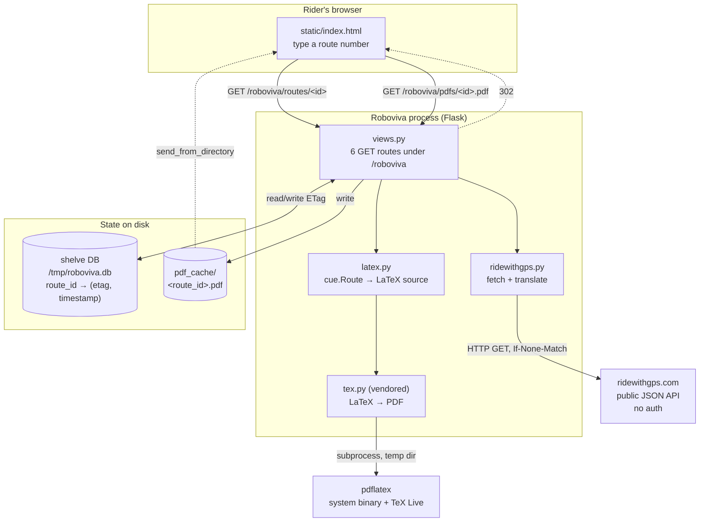
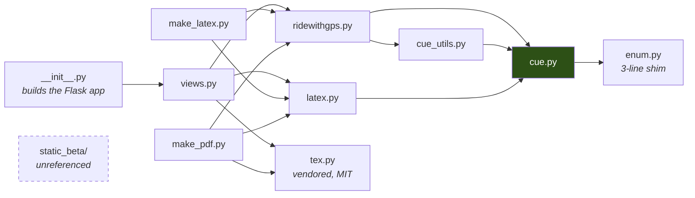

# Architecture

Roboviva is a single Flask process with no database. All of its state is either
a file on disk or a request to RideWithGPS.

## The pieces



Four things live outside the process, and every one of them is a failure mode
the code has an error page for:

| External | Failure shows up as |
|---|---|
| RideWithGPS | `"'<id>' is not a valid RideWithGPS Route"`, or `Guru Meditation: 0xFA` |
| `pdflatex` | `Guru Meditation: 0xFF` |
| `pdf_cache/` directory | `Guru Meditation: 0xCE` |
| shelve DB | no handler — an unhandled error here is a 500 |

All of those error pages return **HTTP 200**. See
[design-decisions.md](design-decisions.md#all-errors-return-http-200).

## Module dependencies



`cue.py` is the sink every layer agrees on. It has no dependencies of its own
beyond the enum shim, and nothing in it does I/O — which is why the
RideWithGPS-facing and LaTeX-facing halves of the codebase can be understood
independently. A rewrite that keeps one clean boundary should keep this one.

`static_beta/` is referenced by no Python code on this branch. It is an
abandoned UI variant; the direction continued on the `python3` branch.

## The Flask app is built at import time

`roboviva/__init__.py` does its work when the module is first imported, not in
a factory function:

```python
app = Flask(__name__, static_url_path='')          # :28
app.config.from_object('config')                   # :29
app.register_blueprint(blueprint, url_prefix="/roboviva")   # :30
shelve.init_app(app)                               # :38
```

Two consequences worth knowing:

- **Config must be set before the import.** `shelve.init_app` reads
  `SHELVE_FILENAME` immediately, so changing it afterwards does nothing. The
  repo's own `roboviva_tests.py:10` sets it after importing and therefore does
  not actually isolate its shelve file. The harness works around this by
  purging `sys.modules` and re-importing per scenario
  (`harness/oracle/bridge.py`).
- **There is no app factory**, so there is no supported way to run two
  configurations in one process.

`roboviva/__init__.py:25-26` also does `reload(sys); sys.setdefaultencoding("utf8")`
— a process-global Python 2 hack that changes how `str` and `unicode` mix. The
LaTeX escaping depends on it, so it is not incidental. See
[design-decisions.md](design-decisions.md#syssetdefaultencodingutf8).

## Static files are mounted twice

`Flask(__name__, static_url_path='')` serves `roboviva/static/` from the app
root, and the blueprint (`views.py:29`) mounts the *same folder* again under
`/roboviva`. So `robo.css` answers at both `/robo.css` and
`/roboviva/robo.css`.

This is harmless but load-bearing: `index.html` and `tips.html` use relative
links (`href="robo.css"`, `href="tips.html"`), and `robo.js` builds its target
as `"routes/" + value`. Those only resolve correctly when the page is served
from under `/roboviva/`. A rewrite that serves assets once must keep the
prefixed mount.

## Runtime dependencies

**Python 2.7** — hard requirement on this branch. `latex.py` uses `ur''`
literals, which are a syntax error in Python 3.

**Python packages** — Flask and Flask-Shelve. Nothing is pinned anywhere; the
repo has no `requirements.txt`, `setup.py`, or `pyproject.toml`. The harness
pins a working set in `harness/oracle/requirements.txt` (Flask 1.1.4), chosen
as the newest releases that still import the legacy code — an approximation of
the original deployment, not a record of it.

**A TeX installation** with these packages, loaded unconditionally by every
document (`latex.py:167-182`):

| Package | Provides | Debian package |
|---|---|---|
| `geometry`, `colortbl`, `amsmath`, `fancyhdr` | page setup, row colours, `\underset` | `texlive-latex-base`, `-recommended` |
| `supertabular`, `lastpage` | multi-page tables, `\pageref{LastPage}` | `texlive-latex-extra` |
| `helvet` | the sans font the whole sheet uses | `texlive-fonts-recommended` |
| `fourier`, `bbding`, `ifsym` | `\danger`, `\Plus`, `\Mountain` | `texlive-fonts-extra` (513 MB) |

That last row is why the oracle image is 2.5 GB for the sake of three symbols.

**Network access** to `ridewithgps.com` over plain HTTP (which now redirects to
HTTPS).
