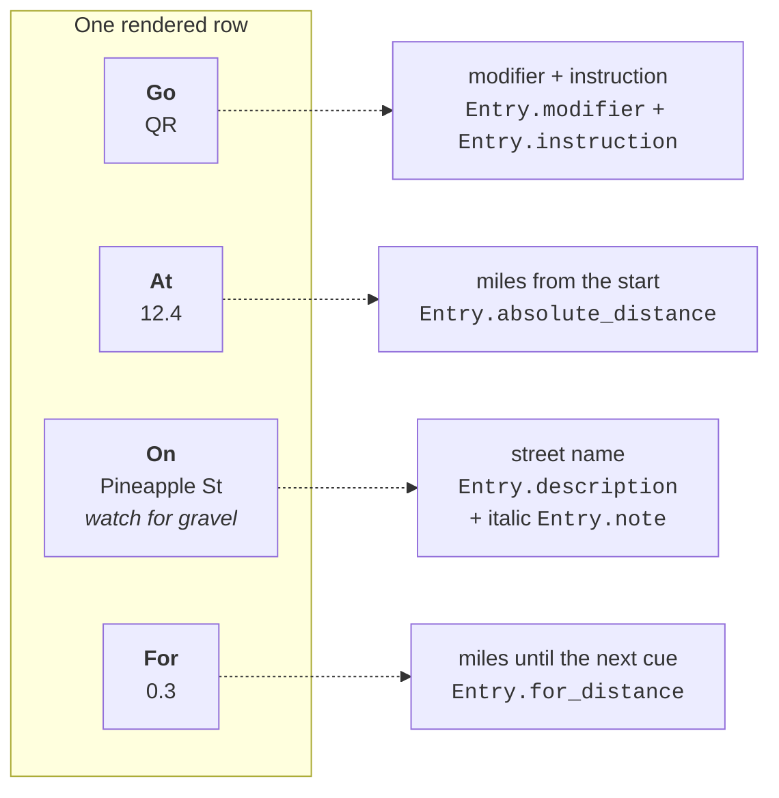

# Authoring cue sheets

The rider-facing feature set. Roboviva has no editing UI of its own — every
feature is expressed by typing something into a RideWithGPS cue entry, because
RideWithGPS is the only place the data lives.

Most of this is documented in `roboviva/static/tips.html`. One shipped feature
is not, and is flagged below.

## Anatomy of a row



"Go, At, On, For" is standard randonneuring cue sheet vocabulary: *what to do*,
*where*, *onto what*, *for how far*.

## Entry types

Every RideWithGPS course-point type maps to a symbol:

| In RideWithGPS | On the sheet |
|---|---|
| Left / Slight Left / Sharp Left | **L** |
| Right / Slight Right / Sharp Right | **R** (gray row) |
| Straight | **S** |
| Food, Water | **PIT** (yellow row) |
| Danger | ⚠ (yellow row) |
| Summit | mountain glyph, labelled *End* |
| 1st–4th Category, Hors Category | mountain glyph, labelled 1–4 / HC |
| First Aid | ✚ |
| Start, End, Generic, Control | blank Go column |

Roboviva also **infers** two modifiers you cannot set directly:

- **Q** ("quick") — a left or right turn less than 0.1 mi after the previous
  cue.
- **B** ("bear") — a left or right turn whose text starts with "Keep", "Bear"
  or "Slight". Note this is case-sensitive: `Bear right` works, `bear right`
  does not.

Types Roboviva does not know — `Uturn`, `Climb`, `Valley`, and lowercase
`right`/`left`, all of which appear in real public routes — are printed as the
literal word in bold. They still appear, just without a symbol, and lowercase
ones also lose the row shading.

## Custom instructions

Put anything in square brackets at the **start** of a cue entry and it replaces
the Go column (documented in `tips.html`):

```
[U] Head back the way you came
```

renders **U** in the Go column, with "Head back the way you came" in the On
column — the tag is stripped from the visible text.

Rules:

- Must be the first non-whitespace text. `Foo [L] Bar` is ignored.
- Must contain at least one character. `[]` is ignored.
- Only the first bracket group counts. `[L/QR] Foo [Rough]` yields `L/QR`.
- Should be short — nothing enforces it, and a long tag simply makes the Go
  column ugly.

A custom tag also **clears any inferred modifier**, but **keeps the row
colour** from the original type. So `[U]` on a Danger point stays yellow, which
is usually what you want.

## `[start]` and `[end]` — undocumented

**This feature is not in `tips.html`.** It shipped in commit `84291c3` and is
implemented in `cue_utils.py`.

By default Roboviva adds its own "Start of route" and "End of route" rows,
because RideWithGPS does not mark either. Tagging a cue with `[start]` or
`[end]` makes *that* cue become the first or last row instead of getting a
generic one above or below it:

```
[start] Meet at the coffee shop, 7:30am
[end]   Finish at the bar
```

Case does not matter — `[START]` and `[End]` both work. Route 6260667 uses
`[End]`.

Three sharp edges, all verified against the running code:

- **`[start]` on the last cue crashes the whole sheet** (`IndexError` → error
  page).
- **`[end]` on the last cue does nothing**, and the word `end` leaks into the
  Go column.
- **Two `[start]` tags silently delete a cue.**

## Emphasis

`*single asterisks*` render *italic* and `**double asterisks**` render
**bold**, in both the description and the note (`tips.html`).

```
Turn right at the **big red barn**
```

Escape a literal asterisk with `\*`.

Emphasis works in cue rows only — **not in the route name**. `_makeHeader`
escapes the title but never runs the formatter, so `A **bold** title` prints
with the asterisks showing. Nothing documents that distinction.

## Notes

RideWithGPS's *description* field (the longer one, not the turn text) becomes a
second italic line under the street name. If you leave the turn text empty and
fill only the description, the note is promoted and fills the On column on its
own — useful for a "regroup here" row with no turn.

## What will break your sheet

Four things produce no PDF at all. The rider sees only
`Guru Meditation: 0xFF` with no indication of which cue was responsible.

| In a cue | Result |
|---|---|
| A `^` character | **Fatal.** LaTeX reads it as a superscript operator. |
| Non-Latin text (Greek, Cyrillic, CJK, emoji) | **Fatal.** The font stack has no glyphs. |
| A `~` character | Renders, but silently disappears (non-breaking space). |
| `` ` `` or `"` | Renders as typographic quotes rather than what you typed. |

The caret is the one that bites people, because `85^` for a cadence target or
`^ the bridge` for "under the bridge" are natural things to write. Public
route 5334050 is a live example: its author typed LaTeX math into the notes as
a joke, and the sheet has never been renderable.

Everything else is safe. `# & $ _ | < > %` and braces are all escaped properly,
so you cannot break the render — or inject LaTeX — with them.

## Route visibility

Roboviva only works on **public** RideWithGPS routes (`tips.html`). A private
route returns 404 to an unauthenticated request, which Roboviva reports as
`'<id>' is not a valid RideWithGPS Route`. If you need a private route,
`tips.html` suggests copying it to your own account and making the copy public.

## Getting good output

`tips.html` links to [NYCC's guide to better cue
sheets](http://nycc.org/Better_Cue_Sheets) and notes that Roboviva works best
when the RideWithGPS entries have been tidied by hand. That is the honest
summary: the tool formats what you give it, and the normalization rules
(`_cleanDescription`) only clean up RideWithGPS's most common phrasings.
