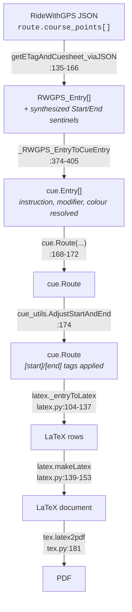
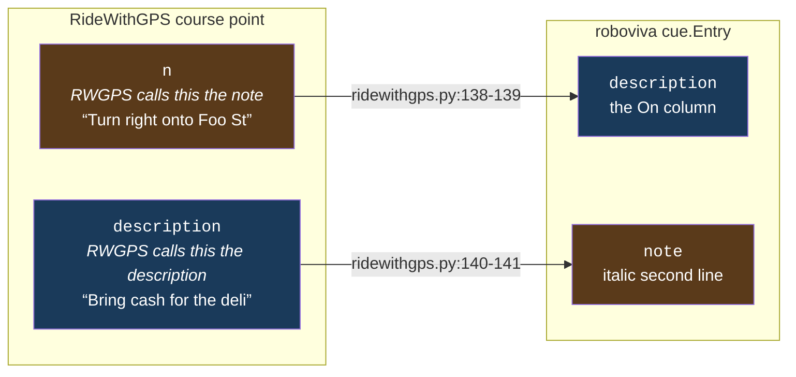
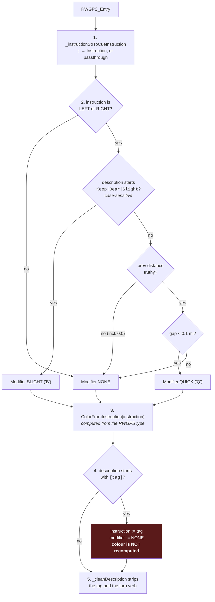

# The cue pipeline

How a RideWithGPS payload becomes a printed cue sheet. This is the document to
read before changing anything.

## Stages



Two stages have no counterpart in the input and are easy to miss:

- **Sentinels.** RideWithGPS does not mark where a route starts or ends, so the
  parser invents both: a `"Start of route"` entry at distance 0
  (`ridewithgps.py:128-133`) and an `"End of route"` entry at the route's total
  length (`:159-164`). The end sentinel exists specifically so the last real cue
  has a correct **For** distance.
- **Tag application.** `AdjustStartAndEnd` runs only on the JSON path
  (`ridewithgps.py:174`). The CSV path skips it entirely.

## The field-name inversion

The single most confusing thing in this codebase. RideWithGPS and roboviva use
the words "note" and "description" for opposite things:



The same swap happens on the CSV path with different column names
(`ridewithgps.py:326-330`: `note` → `description_str`, `description` →
`note_str`). Nothing warns you; the names simply mean the other thing on each
side of the boundary.

## How one entry gets its instruction, modifier and colour



Step 4 is the subtle one. The colour was already decided in step 3 from the
*RideWithGPS* type, and applying a custom tag does not recompute it
(`ridewithgps.py:380-388`). So `[U]` on a `Danger` point shows "U" in the Go
column while keeping its yellow row. That is probably intentional — the hazard
is still a hazard — but it is written down nowhere.
Pinned by `test_custom_tag_overrides_instruction_but_not_colour`.

Step 2 has two quirks that both look accidental:

- The `Keep|Bear|Slight` regex has **no `re.I`** (`ridewithgps.py:309`), unlike
  every rule in `_cleanDescription`. So "bear right" lowercase falls through to
  the distance check instead of being marked slight.
- `elif entry.prev_absolute_distance:` (`:311`) is a truthiness test, and
  `0.0` is falsy. A turn 50 m after the route start — unambiguously quick — is
  not marked quick, purely because the previous entry sits at mile 0.

The `quick_threshold_mi=0.1` parameter in the signature is **never used**; the
comparison hard-codes `0.1` at `:314`. The repo's own test asserts otherwise and
has been failing for years.

## Description normalization

`_cleanDescription` (`ridewithgps.py:252-261`) is ten `re.sub` calls applied in
order. RideWithGPS puts the turn direction *in the text* ("Turn right onto Foo
St"), which is redundant next to the Go column and blows out the narrow On
column, so it is stripped.

| # | Pattern | → | Note |
|---|---|---|---|
| 1 | `^\s*\[[^\]]+\]\s*` | *(removed)* | strips the custom tag |
| 2 | `^At the traffic circle,` | `@ Circle,` | |
| 3 | `^(Slight\|Turn\|Bear\|Keep) (left\|right) (toward\|onto\|on) ` | *(removed)* | the common case |
| 4 | `^(Slight\|Turn\|Bear\|Keep) (left\|right) to stay on` | `TRO` | |
| 5 | `to stay on` | `TRO` | **unanchored** — rewrites mid-string |
| 6 | `to remain on` | `TRO` | unanchored |
| 7 | `^(Slight\|Turn\|Bear\|Keep) (left\|right) ` | *(removed)* | no preposition |
| 8 | `^(Left\|Right) onto ` | *(removed)* | no leading verb |
| 9 | `^Continue onto ` | *(removed)* | |
| 10 | `^Continue straight (onto\|on) ` | *(removed)* | |

All are case-insensitive except rule 1. Order matters: rule 3 must run before
rule 7, and rules 5–6 rewrite mid-string, so `"Turn left onto Bar to stay on
Baz"` becomes `"Bar TRO Baz"`.

**`Sharp` is missing from every alternation** even though `Sharp Left` and
`Sharp Right` are recognized instruction types (`:268-271`). So "Sharp left onto
Foo" keeps its redundant prefix. This is not theoretical — route 47438923 has
Sharp Left and Sharp Right points. Pinned by
`test_clean_description[sharp_left_NOT_stripped]`.

## Instruction mapping

`_instructionStrToCueInstruction` (`:264-296`) is an exact, case-sensitive
lookup with a passthrough fallback:

| RideWithGPS `t` | → | Renders as |
|---|---|---|
| `Left`, `Slight Left`, `Sharp Left` | `LEFT` | **L** |
| `Right`, `Slight Right`, `Sharp Right` | `RIGHT` | **R** |
| `Straight` | `STRAIGHT` | **S** |
| `Food`, `Water` | `PIT` | **PIT**, yellow row |
| `Danger` | `DANGER` | ⚠ glyph, yellow row |
| `Start`, `End`, `Generic`, `Control` | `NONE` | *(blank)*, gray row |
| `Summit` | `SUMMIT` | mountain glyph, "End" |
| `1st`–`4th Category`, `Hors Category` | `CAT_*` | mountain glyph |
| `First Aid` | `FIRST_AID` | ✚ glyph |
| *anything else* | *the string itself* | bold literal text |

The fallback matters more than it looks. Public routes today emit `Uturn`,
`Climb`, `Valley`, and even lowercase `right` / `left` — none of which are in
the table, so all of them print as bold words in the Go column. The lowercase
ones also lose the gray shading a real right turn gets, because
`ColorFromInstruction` never sees `Instruction.RIGHT`.

Nothing RideWithGPS sends ever produces `CAT_5` or `CROSSES`; those are
reachable only by a rider typing `[C5]` or `[X]` as a custom tag.

## Rendering

Each entry becomes one `supertabular` row (`latex.py:132-137`):

```python
r"%s %s & %5.1f & %s%s & %s \\ \hline" % (
    color_str,        # \rowcolor{yellow} / \rowcolor[gray]{0.8} / ""
    instruction_str,  # the Go column glyph or bold text
    absolute_distance,# At
    description_str,  # On
    note_str,         # appended as \newline \textit{...}
    for_str)          # For, or "" when for_distance is falsy
```

**Escaping runs before formatting, and that order is a security boundary.**
`_escape` (`latex.py:48-63`) neutralizes LaTeX specials in user-controlled text;
`_format` (`:65-90`) then converts `*emph*` and `**strong**` into real LaTeX.
Because escaping is first, a rider cannot inject commands — but because
`_format` runs second, the emphasis it produces is trusted output.

The escape set is **incomplete**. It covers `# & $ _ | < > % { }` and U+200B, but
not `^`, `~`, `[`, `]`, `"` or `` ` ``. Of those, `^` is fatal: LaTeX reads it as
a superscript operator outside math mode, the compile aborts, and **no PDF is
produced at all**. One cue containing a caret destroys the entire sheet, and the
rider sees only `Guru Meditation: 0xFF`.

This is not hypothetical. Public route 5334050 has LaTeX math typed into its
notes as a joke; the backslashes are correctly neutralized, but the `^` in
`^{\frac{\pi}{2}}` kills the render. Pinned by
`test_a_real_public_route_cannot_be_rendered_at_all`.

Also note `>` maps to `$\Rightarrow$` — an arrow, not a literal `>`
(`latex.py:58`). Asymmetric with `<`, and almost certainly deliberate: cue
sheets write "A > B" to mean "A leads to B".
