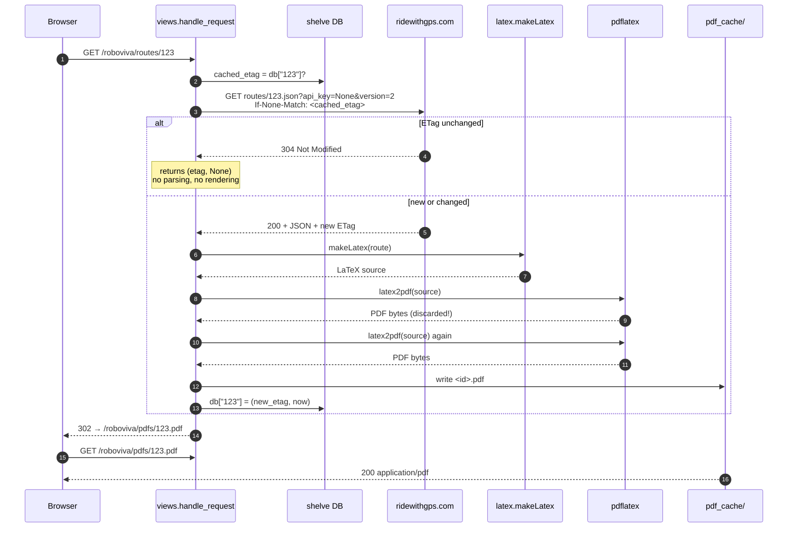
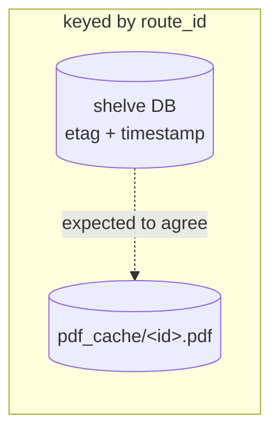

# Request lifecycle

What happens between typing a route number and getting a PDF, and why there are
two caches rather than one.

## The main request



Three things in that diagram are worth stopping on.

**The handler never returns the PDF.** It always ends in a 302 to
`/roboviva/pdfs/<id>.pdf` (`views.py:115-116`), which is a separate route that
just serves a file. That is what makes the PDF URL shareable and
browser-cacheable, and it is why `robo.js` can simply `window.open("routes/" +
value)`.

**`pdflatex` runs twice per regeneration.** `views.py:87` computes `pdf_data`,
and then `views.py:102` calls `latex2pdf(latex)` *again* inside the `open()`
block and writes that second result. The first is discarded. Every cache miss
pays for two full TeX runs — and since `tex.convert` itself re-runs until
`texput.aux` stabilizes, that is four `pdflatex` invocations for a route that
uses `\pageref{LastPage}`. Almost certainly a copy-paste slip.
Pinned by `test_regeneration_invokes_pdflatex_twice`.

**The 304 path is the whole point.** RideWithGPS answering "not modified" saves
the download *and* the render. On a 120-cue route the render is seconds of CPU;
the download is milliseconds. The ETag is really a rendering cache key that
happens to be maintained by someone else's server.

## Two caches, one key



The shelve DB says *what version we last rendered and when*. The file is *the
render itself*. Nothing enforces that they agree, and two endpoints break the
correspondence in opposite directions:

```mermaid
stateDiagram-v2
    [*] --> Absent: nothing cached
    Absent --> Cached: GET /routes/&lt;id&gt;<br/>(fetch, render, write both)
    Cached --> Cached: GET /routes/&lt;id&gt;<br/>304 → no work
    Cached --> Cached: route edited upstream<br/>new ETag → re-render
    Cached --> Absent: GET /cache/purge/&lt;n&gt;<br/>(deletes DB row AND file)

    Cached --> OrphanFile: GET /cache/remove/&lt;id&gt;<br/>deletes DB row only
    OrphanFile --> Cached: GET /routes/&lt;id&gt;<br/>re-renders over the orphan
    note right of OrphanFile
        File on disk, no DB row.
        /cache/purge never sees it,
        so it is never reclaimed.
        Still served by /pdfs/&lt;id&gt;.pdf.
    end note

    Cached --> OrphanRow: file deleted out of band
    OrphanRow --> Broken500: GET /cache/purge/&lt;n&gt;
    note right of Broken500
        views.py:206 calls os.stat
        unguarded → OSError → HTTP 500.
        The only 5xx the app produces.
    end note
```

Both inconsistent states are reachable and both are pinned by tests
(`test_cache_remove_orphans_the_pdf_file`,
`test_purge_500s_when_a_tracked_pdf_is_missing`). Neither is catastrophic — the
PDF is a rebuildable derivative — but a rewrite should decide deliberately
whether the two stores stay independent.

A third state exists that the diagram cannot show: **`pdf_cache/` not existing
at all**. It is gitignored and the app never creates it, so a freshly cloned,
freshly started Roboviva answers its very first request with `Guru Meditation:
0xCE` until someone runs `mkdir pdf_cache`. Nothing in the README mentions
this.

## Serving a PDF that isn't there

`GET /roboviva/pdfs/<id>.pdf` for a missing file renders `regen.html` with
**HTTP 200** rather than a 404 (`views.py:123-124`). The page says "Uh-oh! The
PDF for route #N doesn't exist!" and links back to `/routes/<id>` to rebuild
it. Wrong by HTTP semantics, but it keeps the rider inside the app instead of
handing them a browser error page — the same instinct behind the 200 error
pages.

## Cache ages are rendered as text

`/roboviva/cache` shows each entry's age in one of four bands
(`views.py:147-155`):

```python
if   age < 60:                    "%d sec"
elif age > 60   and age < 3600:   "%d min"
elif age > 3600 and age < 86400:  "%d hr"
else:                             "%.1f days"
```

Both comparisons are strict, so **exactly 60 and exactly 3600 match no branch**
and fall through to the days case. A cache entry that is precisely one minute
old is displayed as `0.0 days`. Pinned by
`test_cache_age_boundaries_fall_through_to_days`.

## Failure paths

Every one of these renders `error.html` and returns **HTTP 200**:

| Trigger | `views.py` | Rider sees |
|---|---|---|
| `RideWithGpsError` (404, or 3 timeouts) | :54-56 | `'123' is not a valid RideWithGPS Route :(` |
| Any other fetch/parse exception | :57-61 | `Error querying RideWithGPS` · `0xFA` |
| `makeLatex` raises | :76-83 | `Internal Error :(` · `0xBA` |
| `latex2pdf` raises | :86-94 | `Internal Error :(` · `0xFF` |
| Cannot write the PDF | :100-108 | `Internal Error :(` · `0xCE` |

Note that an upstream **500 from RideWithGPS produces the "not a valid route"
message**, because `ridewithgps.py:108-109` collapses every non-304 `HTTPError`
into `RideWithGpsError("Unknown Route ID")`. The rider is told their route
number is wrong when the real problem is an outage.

The `0xBA` branch appears to be effectively unreachable in the web app: the
only way `makeLatex` raises is a non-integer `route_id` (`latex.py:186` does
`'%d' % route_id`), and Flask's `<int:route_id>` converter guarantees an
integer before the handler runs.
